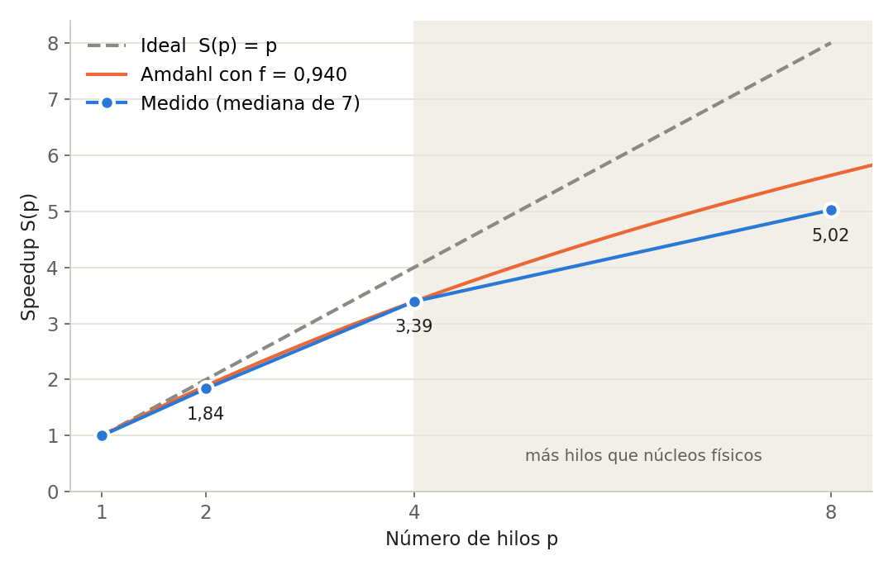

# Integración por Monte Carlo en memoria compartida con OpenMP

Estimación de π por el método de Monte Carlo (acierto y fallo), paralelizada con OpenMP en C.
Evaluación de Introducción a la computación paralela, Universidad Industrial de Santander, 2026-2.

**Estudiante:** Nancy Liliana Saenz Moreno · **Código:** 2224510 · **Semilla usada:** 2224510

La idea: se lanzan N puntos al azar en el cuadrado [0, 1] × [0, 1] y se cuentan los que caen dentro
del cuarto de círculo x² + y² ≤ 1. La proporción tiende a π/4, así que π ≈ 4 · dentro / N.

## Documentos

- [`Documento_Final.pdf`](Documento_Final.pdf): las cuatro partes del examen, con figuras, capturas, bitácora de IA y el código.
- [`Parte_IV/Parte_IV_Informe.pdf`](Parte_IV/Parte_IV_Informe.pdf): el informe de la Parte IV con la bitácora de IA como anexo.

## Resultados principales

Con N = 10⁸ y la semilla 2224510 el programa da **π ≈ 3,141668**, con un error de 7,56 × 10⁻⁵
(menor que el error típico esperado, 1,64 × 10⁻⁴). El conteo de aciertos es **78 541 707** con
1, 2, 4 y 8 hilos, igual al del programa secuencial: el resultado no depende del número de hilos.

Mediana de 7 ejecuciones en un AMD Ryzen 5 3450U (4 núcleos, 8 hilos), Ubuntu en WSL, gcc 15.2.0:

| Hilos p | Mediana T(p) [s] | Speedup S(p) | Eficiencia E(p) |
|:-:|:-:|:-:|:-:|
| 1 | 1,2549 | 1,000 | 1,000 |
| 2 | 0,6826 | 1,838 | 0,919 |
| 4 | 0,3700 | 3,392 | 0,848 |
| 8 | 0,2499 | 5,022 | 0,628 |



## Cómo se paralelizó

El ciclo del programa secuencial se conserva. Las N muestras se dividen en 1000 bloques de 100 000
y OpenMP reparte los bloques entre los hilos:

```c
#pragma omp parallel for reduction(+:dentro) schedule(static)
for (long b = 0; b < nbloques; b++) {
    unsigned int estado = saltar(semilla, b * BLOQUE * 6);
    /* el mismo ciclo del programa secuencial, sobre las muestras del bloque b */
}
```

- `reduction(+:dentro)`: cada hilo cuenta en una copia propia y al final se suman.
- `saltar`: calcula en O(log k) pasos el estado que tendría `rand_r` después de k pasos, así que cada
  bloque empieza justo donde estaría el programa secuencial. Los flujos no se solapan y el resultado
  es el mismo con cualquier número de hilos.

## Estructura

```
Parte_I/     Fundamento del método: experimentos de error frente a N y de reparto en tramos
Parte_II/    Implementación: montecarlo.c (versión paralela final), versión secuencial y
             programas que cometen a propósito cada error (rand compartido, misma semilla,
             sin reduction, default(none))
Parte_III/   Desempeño: tiempos con p = 1, 2, 4, 8, costo de los hilos, frecuencia del
             procesador, static frente a dynamic y gráficas
Parte_IV/    Informe del proceso en PDF
```

Cada parte tiene `codigo/` (programas y scripts), `resultados/` (salidas en texto),
`evidencias/` (capturas de la terminal durante las ejecuciones) y, cuando aplica, `figuras/`.

## Cómo ejecutarlo

Requisitos: Linux o WSL, `gcc` con OpenMP y `bash`. Las gráficas usan Python 3 con `matplotlib`.

```bash
gcc -O2 -fopenmp -Wall -Wextra Parte_II/codigo/montecarlo.c -o montecarlo -lm

./montecarlo 100000000 4              # muestras, hilos y (opcional) semilla
OMP_NUM_THREADS=8 ./montecarlo 100000000
```

Para repetir las pruebas y mediciones: `bash Parte_I/codigo/parte1.sh`,
`bash Parte_II/codigo/compilar.sh` y luego `ii1_secuencial.sh` a `ii4_comparticion.sh`,
`bash Parte_III/codigo/compilar.sh` y luego `tiempos.sh`, `sobrecosto.sh`, `precision.sh`
y `planificacion.sh`.

El uso de herramientas de inteligencia artificial generativa está declarado en la bitácora de IA del informe.
